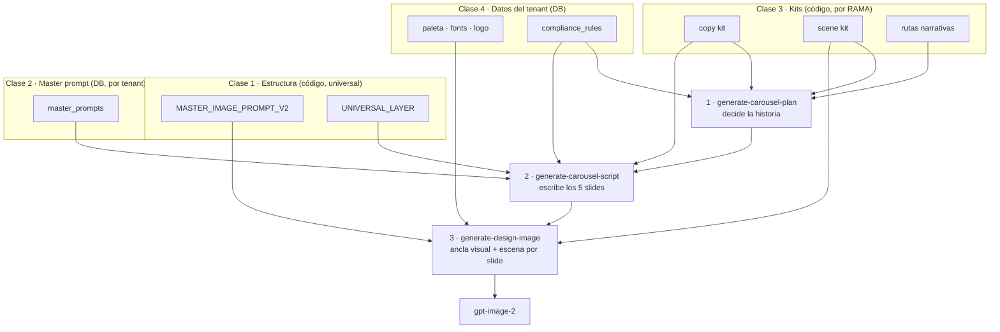

# Mapa de capas de prompt

> Qué pantalla usa qué función, y qué clase de prompt es cada cosa. Es el nivel de
> arriba de `CAROUSEL_PROMPT_STACK_AS_IS.md` (que audita el flujo de datos) y de
> `CAROUSEL_GENERATION_AS_IS.md` (que audita el recorrido completo).
>
> Existe porque "prompt" significa cuatro cosas distintas en este sistema, con
> dueños distintos, y confundirlas lleva a editar donde no tiene efecto.

## 1. Qué está vivo

Estar ruteada no significa estar viva. Varias pantallas siguen en `App.tsx` y en la
rejilla de Herramientas del Home sin que nadie las use. Tomarlas por vivas lleva a
tratar como restricción algo que ya nadie recorre, y a "no degradar" caminos muertos.

| Pantalla | Ruta | Archivo | Estado |
|---|---|---|---|
| Home | `/` | `XendingDesignPage.tsx` | **Vivo el selector de negocio.** Su panel de ideas y sus tarjetas de rama, no |
| Design Studio | `/design-studio` | `DesignStudioPage.tsx` | **Vivo.** Es la herramienta |
| Presentaciones | `/presentations` | `PresentationsPage.tsx` | **Vivo** |
| Paleta de Marca | `/brand-palette` | `BrandPalettePage.tsx` | **Vivo** |
| Nueva Campaña / Pipeline | `/campaign`, `/xending-design/campaign`, `/xending-design/pipeline` | `CampaignWizardPage.tsx` | Sin uso |
| Boletín Express | `/bulletin` | `BulletinPage.tsx` | Sin uso |
| Generar Stock | `/stock-generator` | `StockGeneratorPage.tsx` | Sin uso |
| Biblioteca de Assets | `/assets` | `AssetLibraryPage.tsx` | Sin uso |
| Compliance Wizard | `/compliance` | `ComplianceWizardPage.tsx` | Sin uso |

El Design Studio es el sucesor del Asistente de Campaña: adoptó su generación de
copy y de imagen. Lo que queda del Asistente es la versión anterior de lo mismo.

El archivo del Home se llama `XendingDesignPage.tsx` pero se importa como
`ScoryDesignPage`:

```ts
import ScoryDesignPage from "./pages/XendingDesignPage";
```

Se queda porque ahí vive el selector de negocio activo (`useBusinessTenants` +
`useActiveBusiness`) y ninguna otra pantalla lo tiene. El Design Studio solo lee
`activeBusinessId` del store, así que sin el Home no hay forma de cambiar de tenant.

**UI sin uso no es dato sin uso.** El Compliance Wizard no se usa, pero
`business_tenants.compliance_rules` sí llega a los prompts: `fetchBusinessContext` lo
lee y `generate-carousel-plan` lo suma a las frases prohibidas de la rama. Retirar la
pantalla no retira la regla, y vaciar la columna bajaría una defensa activa.

**`generate-ideas` es la única función con contexto de rama legacy**, y ya no la
alcanza ninguna superficie viva. El panel de ideas del Home no se usa, el botón
"Generar 4 copys" del Design Studio se retiró, y el Asistente de Campaña completo
está sin uso. Ver §5.

## 2. Las cuatro clases de prompt

### Clase 1 — Estructura

Universal, en código. No cambia por marca. Es lo que hace que una marca nueva
funcione sin reescribir nada.

| Qué | Dónde |
|---|---|
| Master image prompt V2 | `src/utils/design-studio/masterImagePrompt.ts` |
| Capa universal de copy | `_shared/buildCopyPromptV2.ts` → `UNIVERSAL_LAYER` |
| Validadores | `_shared/validateCopyV2.ts`, `validateCarouselCreativePlan.ts`, `validateCarouselEconomicScenario.ts` |
| Opciones de fondo | `masterImagePrompt.ts` → `DESIGN_BACKGROUND_OPTIONS` |

Los validadores están aquí a propósito: son lógica, no configuración.

### Clase 2 — Master prompt del tenant

En DB, versionado, editable sin desplegar. Uno por marca. Tabla `master_prompts`,
y el `prompt_type` decide para qué sirve.

| `prompt_type` | Consumidor | Editor |
|---|---|---|
| (nulo / contenido) | `fetchBusinessContext().masterPrompt` | `MasterPromptEditor` |
| `image` | `generate-design-image`, solo si `MASTER_IMAGE_PROMPT_SOURCE=database` | — |
| `image_style:professional`, `image_style:icon_3d`, … | Image Stock Studio | `useImageStylePrompts` |
| `variant`, `claim_validation`, `channel_adapter` | Sus agentes | — |

### Clase 3 — Kits por rama

En código. **Sin eje de tenant**: se resuelven por slug de rama y nada más.

| Kit | Dónde | Qué decide | Override por DB |
|---|---|---|---|
| Copy kit | `_shared/copy-kits/*.json` | Qué **dice** la rama: ángulos, frases prohibidas, CTAs, léxico | Tabla `copy_kits`, solo si `COPY_KIT_SOURCE=database` |
| Scene kit | `_shared/scene-kits/*.ts` | Cómo se **ve** la rama: objetos, superficies con dato, props prohibidos, política de cifras | **Ninguno** |
| Rutas narrativas | `_shared/carouselStoryRegistry.ts` | Qué historias puede contar la rama | Ninguno |
| Léxico | `_shared/carouselLanguageLexicon.ts` | Reescrituras de vocabulario por rama | Ninguno |

La resolución de rama → kit vive en `_shared/branchSlug.ts`
(`BRANCH_KIT_SLUGS`, `ALIASES`, y un fallback laxo por regex).

Estos no son "el prompt de Xending". Son "el prompt de Velocidad". Y como no
distinguen mercado, una rama de otro tenant con un slug parecido recibe el kit de
Xending México.

### Clase 4 — Datos del tenant

No son prompts: se interpolan dentro de ellos. Todos por `business_id`, todos
editables.

| Qué | Tabla | Editor |
|---|---|---|
| Logo, paleta, tipografía | `business_tenants` | `BrandIdentityEditor`, `BrandPalettePage` |
| Reglas de compliance | `business_tenants.compliance_rules` | `ComplianceRulesEditor`, `ComplianceWizardPage` |
| Taxonomía: categorías, ramas, verticales, canales, ángulos | `campaign_categories`, `commercial_branches`, `industry_verticals`, `business_channels`, `business_angles` | `BusinessAdminPage` |
| Banco de copys | `copy_bank_items` | Design Studio |
| Plantillas HTML | `template_registry` | — |

`template_registry` es el único con herencia: busca la plantilla de la marca, si no
existe usa la global (`business_id IS NULL`), si no existe cae a las constantes de
código. Ese patrón es el que conviene reusar cuando algo deba compartirse entre
tenants, en lugar de una jerarquía padre/hijo.

## 3. Qué recibe cada agente del carrusel

El carrusel no tiene un prompt. Tiene tres agentes en cadena, y cada uno recibe una
mezcla distinta de las cuatro clases.



`generate-design-image` hace dos pasos internos: primero un **ancla visual** con
`textInImage=false`, que fija materialidad y paleta para todo el set, y después
**una escena por slide** con `textInImage=true`, que ensambla el ancla dentro del
prompt final.

La imagen individual usa la misma función sin la cadena: un prompt y ya.

## 4. Qué se puede cambiar sin desplegar

| Capa | ¿Sin desplegar? |
|---|---|
| Paleta, logo, tipografía | Sí |
| Reglas de compliance | Sí |
| Master prompt del tenant | Sí, versionado |
| Prompts de estilo de imagen | Sí, versionado |
| Taxonomía y verticales | Sí |
| Plantillas HTML | Sí, insertando en `template_registry` |
| Copy kit | La tabla existe; requiere `COPY_KIT_SOURCE=database` y un editor |
| Scene kit | No |
| Rutas narrativas, léxico | No |
| Estructura y validadores | No, y así debe ser |

## 5. Costuras abiertas

Lo que se sabe que falta, para no volver a descubrirlo.

**`generate-ideas` usa el contexto de rama legacy y no consulta el copy kit.**
`generate-carousel-script` ya hizo esa migración; esta no.

Mitigación aplicada: **una rama que resuelve copy kit no recibe contexto legacy.** La
compuerta es `hasCopyKit = resolveKitSlug(branch.slug ?? branch.name) !== null`, y
cubre los cinco accesos: `strategicBlockFor`, `promptKitFor`, `ctaListFor`,
`legacyOnly` y las dos llamadas a `buildBranchContextBlock`. Se pregunta por el kit
sin cargarlo, porque `branchSlug.ts` no depende del cliente de Supabase.

Efecto: las 4 ramas con kit quedan limpias. `control-operativo-pagos` y
`banco-vs-xending` no resuelven ningún slug y conservan su legacy, porque es el único
contexto que tienen.

Consecuencia asumida: en una rama con kit este agente queda con menos contexto de
rama. Es mejor resultado que inyectarle reglas que su propio kit prohíbe. `buildBranchContextFromKit`
no sirve como reemplazo: está escrito para el agente de carrusel, su prosa habla de
"los cinco slides" y del "SET completo". El bloque editorial para una tanda de copys
es el de `buildCopyPromptV2`, y quien lo usa es `generate-copy-v2`. Esa es la ruta
correcta para copy con contexto de rama.

`strategic_config` llegaba a su prompt por **cuatro puertas independientes**, y solo
una estaba tapada por `prompt_kit`. Ya están cerradas las otras tres:

| Puerta | Estado |
|---|---|
| `buildFromStrategicConfig`, dentro de `buildBranchContextBlock` | Ya estaba tapada: `buildFromPromptKit` gana cuando hay `prompt_kit`, y las 6 ramas lo tienen |
| `buildStrategicBlock`, en los tres system prompts dinámicos | Cerrada con `strategicBlockFor`, que aplica la misma precedencia |
| Variables de plantilla sueltas: `businessPain`, `promise`, `audience`, `mainInsight`, `branchObjective`, `proofPoints`, `diferenciadores`, `footerSuggestions`, `visualGuidelines` | Cerradas con `legacyOnly`, o quitadas |
| Fallback de `ctas` | Quitado |

Cerrar una sola no cambiaba nada: las demás reinyectaban el mismo contenido. Y no era
dato desactualizado, era dato **en contra**. En velocidad, `strategic_config` trae
`dolor: "Tu banco tarda 3-5 días en enviar un pago"` y `claims_permitidos: ["Pagos en
minutos", "Más rápido que tu banco"]`, mientras el copy kit tiene `"Tu banco tarda
días."` en `comparative_rule.not_allowed`, `"más rápido que un banco"` en
`discouraged` e `"instantáneo"`/`"inmediato"` en `banned_phrases`. Y su `guia_visual`
pide fondo oscuro navy con relojes y flechas, contra el fondo claro vigente y contra
los `bannedProps` del scene kit, que prohíben cronómetros, cohetes, rayos y estelas.

Se conserva `avoidClaims` (`claims_prohibidos`): una lista de prohibiciones solo
resta, no puede autorizar nada.

**Bug destapado al quitar el fallback de `ctas`:** el último escalón de la cadena era
`businessCtx.channels.map(ch => ch.name)`, o sea "Instagram Story", "Facebook",
"LinkedIn", inyectados bajo el encabezado "CTAs RECOMENDADOS (usa estos o variaciones
cercanas)". Estaba tapado, no arreglado. Ahora los CTAs salen de
`prompt_kit.cta_recomendados` o de ninguna parte.

### Llamadores de `generate-ideas`

| Llamador | Dónde | Qué pide | Estado |
|---|---|---|---|
| `CopyWorkstation` | Asistente de Campaña paso 2, y desde `BulletinPage` | `type: 'image'`, `'copy'`, `'punchline'` | Sin uso: las dos pantallas están sin uso |
| Paso 2 del pipeline | `pipeline-orchestrator/lib/runPipeline.ts`, `skippable: false` | `content_output` | Sin uso: el pipeline está sin uso |
| Botón "Generar 4 copys" | Design Studio | `type: 'copy'` | Retirado con `handleGenerateCopy` |
| `CombinableGeneratorPanel` | Panel de ideas del Home | `type: 'copy'` | Retirado; el componente se borró |

**Ninguna superficie viva llama a `generate-ideas`.** Los dos llamadores que quedan
en código pertenecen al Asistente de Campaña y al pipeline, que están sin uso (§1).

Por eso la compuerta de arriba no degrada nada en producción: quita una contradicción
de un camino que nadie recorre. Y por eso tampoco urge migrar esta función al copy
kit — el sucesor de esa generación es el Design Studio, no una versión arreglada de
esta.

Retirar `generate-ideas` del todo no es quitar un botón: el paso 2 del pipeline tiene
`skippable: false`, así que arrastra esa pantalla, el pipeline de 6 pasos y sus tablas
de orquestación. Es una decisión de producto, no de limpieza.

Vaciar `prompt_kit` y `strategic_config` ya no tiene consumidor de prompt vivo, pero
tampoco gana nada: `BranchCardGrid` renderiza `strategic_config.objetivo`,
`.audiencia` y `.angulos` en las tarjetas de rama del Home, así que vaciarlo solo
dejaría esas tarjetas en blanco.

**El carrusel no pasa por aquí.** Arranca de un copy ya en banco (`seedCopy` desde
`bankItem.row` en `useCarouselPlan` y `useCarouselQueue`) y resuelve sus reglas con
`getCopyKit` y `getSceneKit`. El origen del texto semilla no decide las reglas: una
fila del banco v1 se evalúa contra el copy kit igual que una del v2.

**Los kits no distinguen tenant.** `getCopyKit` acepta `businessId` pero solo lo usa
cuando `COPY_KIT_SOURCE=database`, que no es el default, así que en la práctica cae
al kit de código. `getSceneKit` no recibe `businessId` en absoluto y no tiene
override por DB. Mitigación en uso: slugs de rama con sufijo de mercado, para que el
aislamiento sea por dato.

**El color tiene dos fuentes de verdad.** `business_tenants.primary_color` y
compañía son editables y llegan al prompt como lista, pero
`_shared/brandColorLanguage.ts` tiene los hex literales y son los que van pegados a
cada regla. Con una paleta distinta a la de Xending, el mismo prompt se contradice y
el modelo obedece al hex explícito. `BRAND_COLOR_BY_ROLE` y
`src/types/design-studio.ts` → `CAROUSEL_ROLE_COLOR` son dos copias más de los
mismos hex, ambas sin consumidores.

**Las opciones de fondo son un union type.** `MasterImageBackgroundStyle` tiene
cuatro valores cableados al master image prompt, así que un fondo nuevo no es una
fila en una tabla: es una rama del prompt.

## 6. Variables de entorno que cambian el comportamiento

| Variable | Default | Efecto |
|---|---|---|
| `COPY_KIT_SOURCE` | código | `database` lee `copy_kits` por tenant, con fallback a código |
| `MASTER_IMAGE_PROMPT_SOURCE` | `code` | `database` lee `master_prompts` con `prompt_type='image'` |
| `MASTER_IMAGE_PROMPT_VERSION` | `v2` | `v1` solo si vale exactamente eso |
